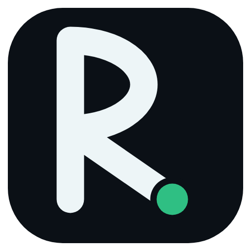
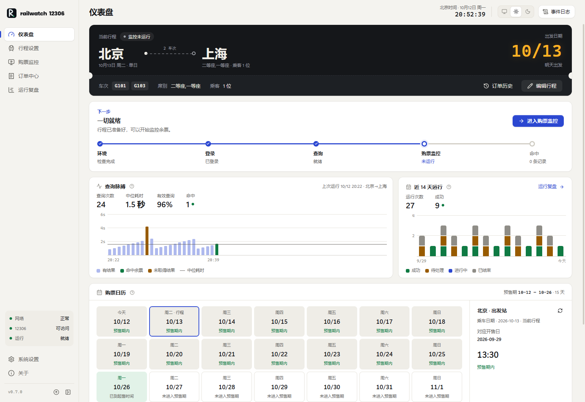
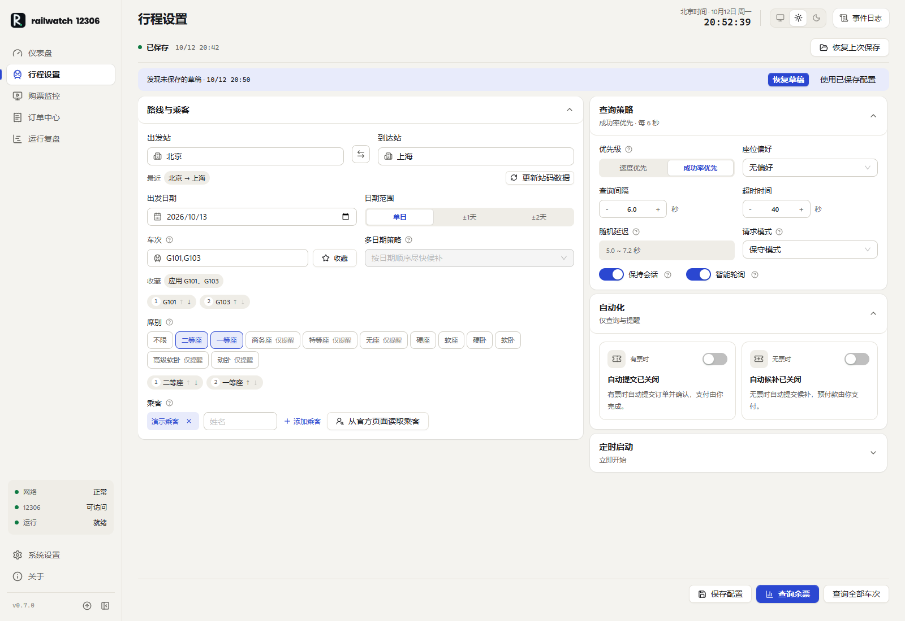
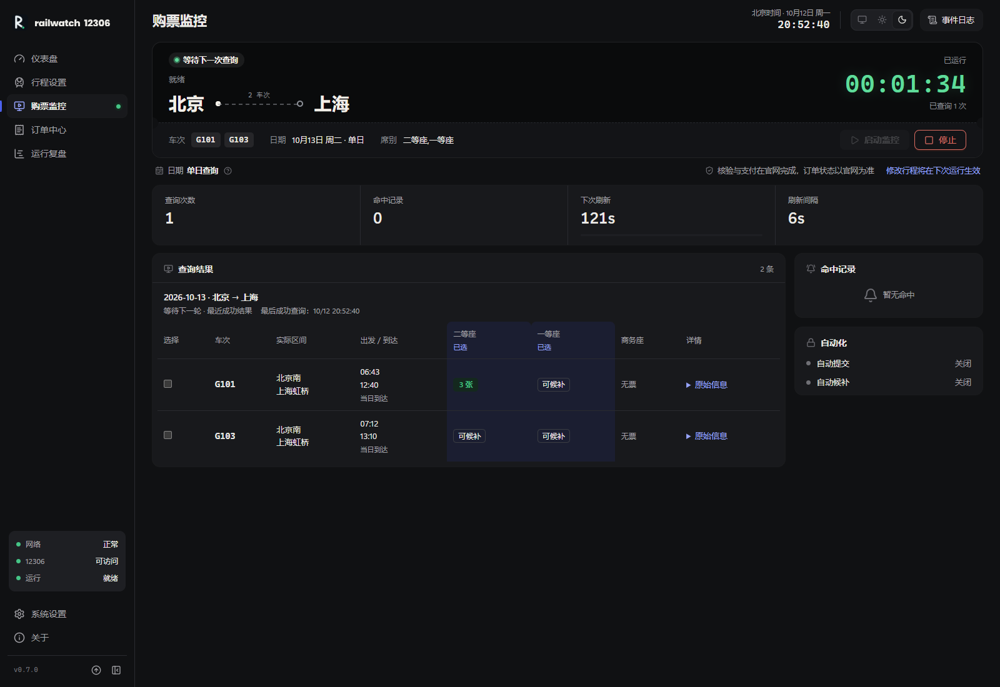
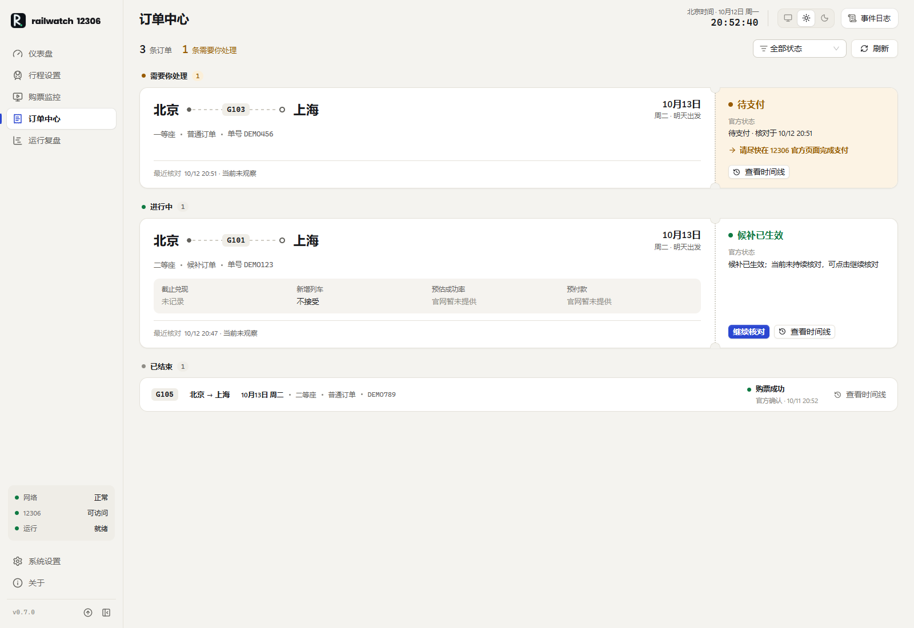

<div align="center">
  
  <h1>RailWatch 12306</h1>
  <p><strong>本地运行的 12306 购票助手</strong></p>
  <p>准点起售 · 自动提交 · 自动候补 · 订单跟踪</p>
  <p>
    <a href="https://github.com/shyrel666/RailWatch-12306/releases/latest"></a>
    <a href="https://github.com/shyrel666/RailWatch-12306/releases"></a>
    
    <a href="LICENSE"></a>
    <a href="https://github.com/shyrel666/RailWatch-12306/stargazers"></a>
  </p>
  <p>
    <a href="https://github.com/shyrel666/RailWatch-12306/releases/latest"><strong>下载最新版</strong></a> ·
    <a href="#quick-start">三步开始</a> ·
    <a href="#screenshots">界面预览</a> ·
    <a href="#faq">常见问题</a> ·
    <a href="CHANGELOG.md">更新日志</a>
  </p>
</div>

<p align="center">
  
</p>

把行程填好，剩下的交给 RailWatch：它在起售时刻准点查询，有票自动提交，无票自动候补，拿到订单号后持续跟踪状态，需要你付款时第一时间提醒。登录和支付始终在 12306 官方页面完成，所有数据只保存在你的电脑上。

<a id="features"></a>

## 功能亮点

<table>
  <tr>
    <td width="50%" valign="top">
      <h3>一次配置，随时复用</h3>
      路线、多日期、车次与席别优先级、乘客一页填完。草稿自动保存，常用路线和车次一键收藏，乘客可直接从官网读取。
    </td>
    <td width="50%" valign="top">
      <h3>准点起售</h3>
      自动查询出发站的起售时刻，购票日历一眼看清哪天开售。定时任务到点开始查询，起售彩排可提前检查登录、乘客与下单路径。
    </td>
  </tr>
  <tr>
    <td valign="top">
      <h3>有票提交，无票候补</h3>
      发现余票自动提交订单；售罄时自动提交候补，支持多组合候补、接受新增列车和官网截止兑现时间，并显示官网预估成功率与预付款。
    </td>
    <td valign="top">
      <h3>订单不丢、不重复</h3>
      自动绑定官方订单号，持续核对待支付与兑现状态。应用退出或重启后恢复原订单，结果未确认前不会再次提交。
    </td>
  </tr>
  <tr>
    <td valign="top">
      <h3>及时提醒</h3>
      桌面通知、循环提示音与窗口置顶，外加邮件、Server 酱、企业微信推送，有票或待支付时不会错过。
    </td>
    <td valign="top">
      <h3>安全可控</h3>
      不需要把账号密码交给工具，不做任何统计上报。登录核验和支付由你在官方页面完成，配置与记录只存在本机。
    </td>
  </tr>
</table>

### 支持的席别

| 席别 | 余票提醒 | 自动提交 | 自动候补 |
| --- | :---: | :---: | :---: |
| 二等座、一等座 | ✓ | ✓ | ✓ |
| 硬座、软座 | ✓ | ✓ | ✓ |
| 硬卧、软卧 | ✓ | ✓ | ✓ |
| 商务座、特等座、无座、高级软卧、动卧 | ✓ | — | — |

卧铺的上、中、下铺由官网分配。

<a id="screenshots"></a>

## 界面预览

<table>
  <tr>
    <td width="33%" align="center" valign="top">
      <a href="docs/images/trip-setup-v0.7.0.png"></a>
      <br><sub><b>行程设置</b> · 路线、席别、乘客与策略</sub>
    </td>
    <td width="33%" align="center" valign="top">
      <a href="docs/images/monitor-v0.7.0.png"></a>
      <br><sub><b>购票监控</b> · 实时查询结果（深色主题）</sub>
    </td>
    <td width="33%" align="center" valign="top">
      <a href="docs/images/order-center-v0.7.0.png"></a>
      <br><sub><b>订单中心</b> · 订单状态与候补详情</sub>
    </td>
  </tr>
</table>

<sub>v0.7.0 截图，使用离线演示数据。</sub>

<a id="download"></a>

## 下载安装

前往 [Releases](https://github.com/shyrel666/RailWatch-12306/releases/latest) 下载安装包。安装包已内置运行环境，只需额外安装 **Google Chrome**。

| 平台 | 安装包 | 更新方式 |
| --- | --- | --- |
| Windows 10/11 | `RailWatch-12306-<版本>-x64.exe` | 应用内自动下载，点击「立即重启安装」 |
| macOS 12+（Apple 芯片） | `RailWatch-12306-<版本>-arm64.dmg` | 应用内提示新版本，点击「前往下载」 |
| macOS 12+（Intel 芯片） | `RailWatch-12306-<版本>-x64.dmg` | 同上 |

<details>
<summary><b>macOS 安装说明</b></summary>

<br>

1. **选择版本**：「苹果菜单 → 关于本机」中芯片为 Apple M 系列选 `arm64.dmg`，Intel 选 `x64.dmg`。
2. **安装**：打开 DMG，把 RailWatch 12306 拖入「应用程序」。
3. **首次打开**：安装包暂未经 Apple 公证，系统会提示无法验证开发者。先尝试打开一次，再到「系统设置 → 隐私与安全性」点击「仍要打开」；也可以在终端执行：

   ```bash
   xattr -dr com.apple.quarantine "/Applications/RailWatch 12306.app"
   ```

4. **钥匙串授权**：通知渠道的密钥保存在系统钥匙串中。升级后首次启动可能弹出授权框（发起程序为 `railwatch_runtime`），选择「始终允许」即可。
5. **升级**：下载新的 DMG 覆盖安装，配置和订单记录会保留。

</details>

<a id="quick-start"></a>

## 三步开始

1. **准备环境**：打开「系统设置」，点击「检查环境」，再点击「打开登录」在 12306 官方页面登录。
2. **填写行程**：在「行程设置」中选择路线、日期、车次、席别和乘客，点击「查询余票」确认结果。需要抢起售票时，在「定时启动」中一键套用起售时间。
3. **开始监控**：按需开启自动提交或自动候补，然后在「购票监控」中点击「启动监控」。收到提醒后，到官方页面完成支付即可。

<a id="faq"></a>

## 常见问题

<details>
<summary><b>能保证买到票吗？</b></summary>

不能。RailWatch 帮你更快、更稳定地发现余票并完成提交，但是否有票、候补能否兑现由 12306 决定。
</details>

<details>
<summary><b>需要提供 12306 账号密码吗？</b></summary>

不需要。你在受控的 Chrome 窗口中、于官方页面登录，RailWatch 不读取也不保存你的 12306 密码。
</details>

<details>
<summary><b>支付怎么完成？</b></summary>

订单进入待支付后，RailWatch 会通过桌面通知和你配置的渠道提醒你，并保留付款页面。支付始终由你在官方页面完成。
</details>

<details>
<summary><b>关闭窗口后还会继续监控吗？</b></summary>

在「系统设置 → 运行偏好」中开启「关闭到托盘」，关闭窗口后监控会在后台继续。
</details>

<details>
<summary><b>中途退出或电脑重启，订单会丢吗？</b></summary>

不会。订单意图和官方订单号保存在本机，重新打开后会恢复原订单并提示你继续核对，确认结果之前不会重复提交。
</details>

<a id="development"></a>

## 源码运行

**技术栈**：Electron · React · Ant Design · TypeScript · Vite（界面）＋ Python · Selenium（运行时）

需要 **Node.js 22.13+、Python 3.10+、Chrome** 及匹配的 ChromeDriver。以 Windows PowerShell 为例：

```powershell
git clone https://github.com/shyrel666/RailWatch-12306.git
cd RailWatch-12306
python -m venv .venv
.\.venv\Scripts\Activate.ps1
python -m pip install -r requirements.txt
npm ci
npm run dev
```

## 参与贡献

欢迎提交 [Issue](https://github.com/shyrel666/RailWatch-12306/issues) 与 Pull Request，开始前请阅读[贡献指南](CONTRIBUTING.md)；安全问题请按[安全策略](SECURITY.md)报告。反馈时请隐去姓名、证件号和订单号。

## 许可与声明

本项目采用 [MIT License](LICENSE)。RailWatch 12306 不是 12306 官方产品，与中国铁路无关联；请遵守 12306 用户协议与网站规则，订单状态以官方页面为准。
